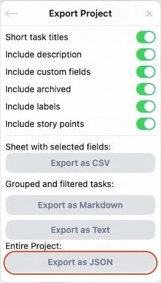

# Save my Ora (Ora Attachments Exporter)

Ora (ora.pm) is shutting down on Saturday, October 31, 2026. This project saves your data before it disappears:

1. the **"Save my Ora" bookmark** saves your projects in one ZIP file: Ora's official JSON export, a spreadsheet (CSV) of every project, and what Ora's exports leave out (the order of lists and tasks, custom fields, views, sprints, Team Chat…);
2. **`ora_attachments.py`** then reads that ZIP and downloads the files attached to your tasks (images, PDFs…), which Ora stores separately, sorted by project and by task.

Do them **in this order**: the second step needs the ZIP from the first. A web page cannot download the attached files itself (Ora's file servers forbid it), which is why there are two steps.

> ⏰ **Do it soon.** Once Ora shuts down, nothing can be downloaded anymore.

---

## Quick guide (Mac)

About 10 minutes of your time, plus the backup itself: from a few minutes to 1 or 2 hours for a big account (2 or 3 requests per task). Nothing to buy, nothing to install.

### 1. Save your data

1. Open **https://bleuetdesign.github.io/ora-attachments-exporter/** and drag the **Save my Ora** button to your bookmarks bar.
2. Open **https://app.ora.pm**, log in, then click **Save my Ora** in your bookmarks bar, and **Start a new backup** in the box that appears.
3. A box shows the progress and the time left. **Keep the tab open and visible** (in its own window if you want to use other tabs) and your Mac **awake and plugged in** until it says **Done**. If you must stop, click **Stop and save now**: the ZIP holds everything saved so far. To continue later, click the bookmark again, choose **Resume from a ZIP…** and pick that ZIP: the backup goes on exactly where it stopped.

The file **`ora-backup-<date>.zip`** lands in your **Downloads** folder.

### 2. Download the attachments

1. On the same page, click **Download ora_attachments.py**. It lands in **Downloads** too.
2. Open **Terminal**: press **⌘ Command + Space**, type **`Terminal`**, press **Return**.
3. Type **`python3`** followed by **a space**, drag **`ora_attachments.py`** from Finder into the Terminal window, then press **Return**.

The tool finds the ZIP by itself. Lines scroll by, one per file. At the end, a **Summary** appears and the **Documents → Ora - Attachments** folder opens.

- The first time, a window may offer to install the **"command line developer tools"**: click **Install**, wait until it finishes (about 10 minutes), then do step 3 again.
- If some files **failed**, do step 3 again (or press **↑** then **Return**): the tool only fetches what is missing. A **`missing_remote`** failure means the file no longer exists at Ora.

### What you will find in `Ora - Attachments`

```
#My project/
  #489 - Task title/
    2457898 - image.png        ← the file, filed under its task
  _no-task/                    ← files whose task is not in the export
_pictures/                     ← project pictures and member photos
manifest.csv                   ← the list of all files (opens in Excel or Numbers)
external-links.csv             ← Google Drive, Figma… links for you to save yourself
```

Keep the ZIP as well: it holds your projects themselves.

### Which file is for what

| File | What it is | What it is for |
|---|---|---|
| `<project>.json` (in the ZIP) | Ora's official **Export as JSON**, identical to its button | Importing your projects into another tool |
| `<project>.csv` (in the ZIP) | A spreadsheet of every task, archived ones included, with comments, labels, custom fields and attachment links | Reading your tasks in Excel or Numbers |
| `ora-complement.json` (in the ZIP) | Ora's own data for what the exports leave out | A future import that rebuilds your projects exactly |
| `Ora - Attachments` folder | Your attached files, one folder per task | Keeping your files |

You no longer need Ora's own **Export as JSON** and **Export as CSV** buttons: the bookmark gives you the same JSON, for all your projects at once, and a more complete CSV.

---

## Troubleshooting

| What you see | What to do |
|---|---|
| `command not found: python3` | Type `python3 --version` and install the developer tools it offers (step 2). |
| `can't open file … ora_attachments.py` | **Drag** the file into Terminal instead of typing its name. |
| `No ora-backup-….zip file in …/Downloads` | Do step 1 first, or move the ZIP back into **Downloads**. |
| The bookmark does nothing | Click it on the **app.ora.pm** tab, once you are logged in. |
| Fewer `.json` than `.csv` files in the ZIP | Ora only gives its official JSON export for projects you administer. The other projects have their `.csv` and their data in `ora-complement.json`, and their attachments are still downloaded (from the CSV). |
| `TLS certificate error` | Open the **Applications** folder, then the **Python 3.x** folder, and double-click **Install Certificates.command**. Then run the command again. |
| The connection dropped, or you closed the window | Run the same command again: nothing is lost, the tool resumes where it stopped. |

---

## Windows and Linux

Saving with the bookmark works the same in any browser. For the attachments:

- **Windows:** install Python from [python.org](https://www.python.org/downloads/), ticking **"Add python.exe to PATH"**. Open **Command Prompt**, type `python` and a space, drag `ora_attachments.py` into the window, press **Enter**. The files go into `Documents\Ora - Attachments`; if Windows complains about path length, add `--out C:\Ora`.
- **Linux:** Python 3 is almost always already installed. Run `python3 ora_attachments.py` in a terminal.

---

## Without the bookmark

You can also export each project yourself in Ora: open the project, click **`…`**, then **Export Project**, and under **Entire Project**, **Export as JSON** (not CSV: it contains almost no attachments).



Put the `.json` files in a folder, for example **Documents → Ora - Exports**, then give that folder to the tool:

```
python3 ora_attachments.py export --exports "<your exports folder>" --pictures
```

That export does not contain the order of lists and tasks, custom fields, workflows, views, sprints, recurring tasks, templates, folders, favorites or Team Chat. To save those without the bookmark, paste [`docs/ora_backup.js`](docs/ora_backup.js) into the browser console on app.ora.pm (**⌥ Option + ⌘ Command + J** in Chrome; Chrome asks you to type `allow pasting` first). It downloads the same ZIP as the bookmark.

---

## Reference

Python 3.9 or later. Standard library only: nothing to install.

```sh
# Download (resumes where it stopped if run again). With no arguments at all: export --pictures with the defaults below.
python3 ora_attachments.py export [--exports "<folder, file or ZIP>"] [--out "<folder>"] [--source json|csv|auto] [--pictures] [--dry-run]

# Sort files you already downloaded some other way, without downloading anything
python3 ora_attachments.py relink --exports "<folder, file or ZIP>" --files "<folder>" --out "<folder>"

# Check the files (presence, size, SHA-256). Non-zero exit code if there is a problem.
python3 ora_attachments.py verify --out "<folder>"
```

- `--exports` defaults to the newest `ora-backup-*.zip` in **Downloads**; `--out` defaults to **Documents/Ora - Attachments**.
- `--source auto` (default) uses a project's JSON if present, otherwise its CSV.
- `--pictures` also saves project pictures and member photos into `_pictures/`.
- `--dry-run` shows the plan without writing or downloading anything.
- `relink` finds each file by its S3 key name (last segment of the URL), or by its SHA-256 if `--files` contains a `manifest.json`. Files are copied, never moved.

Manifest statuses: `ok`, `skipped` (already present and verified on a rerun), `failed`, `size_mismatch` (size differs from Ora's `fileSize`) and `missing_remote` (403 or 404: the file no longer exists on S3).

### What is in the ZIP

- One `<project>.json` per project you administer: the same file as Ora's **Export as JSON** button.
- One `<project>.csv` per project: the columns of Ora's **Export as CSV** with every option on (description and comments, labels, attachments, story points, custom fields), plus an `Archived` column. Unlike Ora's, it has every task, archived ones included, full titles, dates as `YYYY-MM-DD`, and a status for projects with workflows. `ora_attachments.py` uses it for projects that have no `.json`.
- `ora-complement.json`: Ora's own answers, unchanged, for every project you can see (positions, custom fields, workflows, views, sprints, recurring tasks, templates, folders, favorites, Team Chat), and for every task its history, comments, timers and watchers. Ora keeps watchers, list automations and a few project settings for project admins: for the projects you don't administer, the backup skips them and lists those projects in `notAdministered`. Nothing reads it yet: it lets a future import rebuild your projects as they were. `ora_attachments.py` leaves it alone.

### CSV limitation

Ora's default CSV has **no attachment column** and only contains active tasks. The only files that can be found in it are the images embedded in task descriptions. In one real export, that was 15 files, versus 246 attachments in the JSON. The tool prints a warning whenever a project is read from such a CSV. A CSV with an `Attachments` column (Ora's **Attachments** option, or the bookmark's CSV) is read in full.

### What the tools do not do

- `ora_attachments.py` **never** calls the Ora API (`api.ora.pm`, GraphQL, WebSocket) and never logs in to **any** account. It only makes HTTP GET requests to the public URLs found in the exports. It **never** writes into the exports folder.
- The bookmark ([`docs/ora_backup.js`](docs/ora_backup.js)) is the only part that talks to Ora. It runs in your browser, with the session you are logged in with, and only sends read requests from a fixed list, one at a time. It sends nothing anywhere else and does not save your session key.
- External links (Google Drive, Figma…) are not downloaded: they are listed in `external-links.csv`.

### Privacy

S3 links are public, and the exports contain the members' email addresses and your Team Chat messages. Sharing the tools is fine. Do not share your ZIP, your exports or your `Ora - Attachments` folder.

### Tests

```sh
python3 -m unittest discover -s tests
```

The tests use fictitious fixtures and a local fake S3 server. No real data is stored in this repository.

## License

MIT — see [LICENSE](LICENSE).

## Thanks

- [u/Logical_Speed_8622](https://www.reddit.com/user/Logical_Speed_8622/) on Reddit, for finding and fixing the bare S3 key bug in 1.1.0.
- Ora's team, for a great piece of software. This project is independent and not affiliated with Ora.
